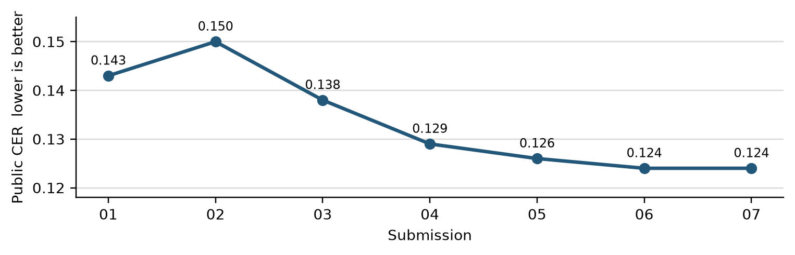
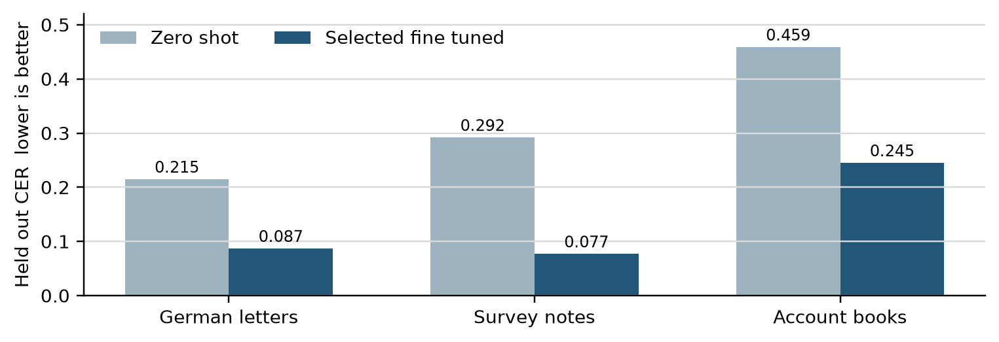

# Badger Scribe Team Bücherwurm Research Draft

Repository: [github.com/RainJiayuSun-star/badger-scribe-bucherwurm](https://github.com/RainJiayuSun-star/badger-scribe-bucherwurm)

We built a reproducible, single-GPU handwriting transcription pipeline for three document types that differ in script, layout, and label quality. The strongest result is a category-routed system: Churro-3B with LoRA adapters for German letters and survey notes, and olmOCR-2-7B with a LoRA adapter for account books. It improved our public character error rate from 0.143 to 0.124. The largest remaining uncertainty is the account-book evaluation, because 34 of its 36 training labels are unverified machine drafts.

## 1. Problem and evaluation

[Badger Scribe](https://www.kaggle.com/competitions/badger-scribe) asks systems to transcribe archival page images exactly as written. The official metric computes character error rate (CER) per page, caps it at 1.0, averages within each of three categories, and then gives each category equal weight. Whitespace is normalized, but spelling, case, punctuation, and reading order count.

Our first local comparison used a frozen 95-page, document-level holdout. A simple zero-shot Churro-3B baseline scored 0.3189 macro CER; the best single zero-shot model, olmOCR-2-7B, scored 0.2956. We later adopted leave-one-document-out validation: four German letter folds, nine survey notebook folds, and six account groups. This avoids training and validation pages from the same letter. Local validation correctly identified large changes such as fine-tuning and category routing, but it is not a reliable proxy for small English gains because almost all English references are machine drafts. For example, 5% loss truncation improved three account folds by 0.0104 but left the public score unchanged at 0.124.

## 2. Data

The release has 619 training pages and 208 test pages. German letters contribute 295 train and 141 test pages; all training labels are human. Survey notes contribute 288 train and 31 test pages, but only 16 training labels are human. Account books contribute 36 train and 36 test pages, with only two human labels. Category balance therefore differs sharply from score balance, and label quality is confounded with document type.

Three properties shaped our design. First, German uses Kurrent handwriting, while the English collections use Latin cursive. Second, layouts range from prose letters to dense ledgers and two-page survey spreads. Third, the metric rewards verbatim text while the English silver labels can modernize spelling or invent text. The German letters all come from one writer, which makes within-writer fine-tuning effective even when whole letters are held out. Dense account pages and survey spreads remain harder because reading order and small writing compete for a fixed image-token budget.

## 3. Methods

The end-to-end pipeline is: page image and published category, then category-specific preprocessing and prompt, then a pinned open-weight base model with a LoRA adapter, then greedy decoding with a repetition-loop guard, and finally a validated submission CSV. It never reads `label_source` during inference.

We began with a single Churro-3B model and one verbatim prompt. Fine-tuning uses rank-16 LoRA, bf16 base weights, an effective batch of eight, three epochs, a 1e-4 learning rate, and document-level folds. Target loss excludes the prompt, image tokens, and illegible `#` reference tokens. English human labels are repeated three times. Images are capped near 1 MP, or 2 MP for survey spreads. A deterministic loop guard stops repeated blocks and reduced German zero-shot CER from 0.274 to 0.215.

Model screening showed complementary strengths. Churro was strongest on German, while olmOCR was much better on English. We therefore load one model at a time and route by the published category. The selected system uses `stanford-oval/churro-3B` at revision `ca2150e` for German and surveys, and `allenai/olmOCR-2-7B-1025` at revision `e52d6f0` for accounts. This differs from our First Steps plan, which emphasized one general model. The routed pipeline, resumable training, local prediction, validation, and safety checks run end to end. Human account-label correction and survey-spread splitting are still incomplete.

## 4. Tools and resources

We used Claude Code, Codex, and Cursor for code review, tests, run orchestration, documentation, and research synthesis. They accelerated repetitive engineering but required explicit safeguards: agents were prohibited from opening test images or reading test predictions, and closed models were used only for preparation. Early experiments used Churro through the BadgerBrain gateway; the final pipeline moved to local open-weight inference for reproducibility. Training and inference ran on UW EFabric A5000 24 GB and A100 40 GB workspaces. We used no AWS resources and recorded no direct compute charge. Shared workspaces occasionally restarted or exhausted storage, so we added resumable jobs, small trainable-only checkpoints, status checks, and automatic workspace renewal.

## 5. Results

Fine-tuning produced the clearest local improvement. Across four held-out German letters, Churro fell from 0.215 zero-shot CER to 0.0872. Fine-tuned models also stopped looping. Two held-out survey notebooks scored 0.049 and 0.109, but 97 of their 101 pages use silver references, so those numbers may partly measure agreement with the drafting model. Six account folds reached 0.3265 with Churro. Switching the account base to olmOCR improved three representative folds from a 0.2909 mean to 0.2452 at their best epochs and improved the public score from 0.138 to 0.129 when only account predictions changed.

Subsequent German changes lowered the public score to 0.124. The final loss-truncation experiment illustrates the validation problem: it improved account draft-label CER but did not move the leaderboard. Other negative results included catalog metadata, which worsened zero-shot macro CER from 0.3189 to 0.3938; higher image budgets, which were inconsistent and increased loops; retry sampling and output voting, which missed our 0.005 gain threshold; and account-only training, which was worse than mixing accounts with surveys.

Three failure modes recur. Zero-shot German can repeat plausible lines indefinitely, which the loop guard fixes. Survey models can read both pages but return them in the wrong order, which needs layout-aware splitting rather than more decoding. On account envelopes, models sometimes describe stamps or graphics instead of transcribing handwriting. The account-label review now presents independent Churro, olmOCR, LightOn, and Codex drafts beside each training image so a human can correct the highest-disagreement pages first.

## 6. Reproducibility and deployment

A user installs the locked `uv` environment, downloads the released competition data and published adapters, and runs `python -m finetune.predict` with category-to-adapter mappings documented in the repository. Every base model is pinned by revision, and each run records the commit, configuration, peak memory, and wall time. The current full test prediction processes 208 pages in about 38.5 minutes on one A5000, or 11 seconds per page on average, with 18.37 GiB peak reserved memory. A non-ML user would need the data, adapters, one CUDA GPU, and the single prediction command.

## 7. Next steps

Before the December 2 final, our first priority is human review of the 34 silver account labels. Success means lower CER on the two existing human pages and on a corrected held-out subset, with draft-label CER reported separately. Second, we will split survey spreads and merge outputs in explicit reading order; success requires a paired gain on both scored survey notebooks without changing other categories. Third, we will publish the selected adapters, finish `WRITEUP.md`, add required attribution, and tag the exact submission commit.

With another month, we would test licensed external Kurrent data and calibrate disagreement between independently trained systems as a page-level confidence signal. We would keep these only if gains hold on whole-document validation and do not increase spelling modernization.

## 8. Borrowed and built

We used the organizers' metric, transcription conventions, starter LoRA lesson, and released labels; Churro-3B and olmOCR-2-7B supplied the base recognizers. The category-router idea emerged from our Wave 1 model comparison. We added document-level folds, target masking, category-specific image budgets, safe resumable training, a loop guard, multi-base prediction, an operations dashboard, and a local human-review tool. Other teams can reuse the benchmark tables, fold generator, submission validator, and run-safety tooling.

## 10. Team contributions

- Ian Gloege: fine-tuning and inference pipeline, experiment design and execution, EFabric automation, validation, compliance checks, and writeup.
- Rain Sun: initial gateway pipeline, benchmark framework and Wave 1 model comparison, first fine-tuning harness, dataset split tooling, and repository setup.

## 11. Challenge-specific requirements

The repository is linked at the top. The submitted pipeline uses open-weight Churro-3B and olmOCR-2-7B models on one GPU; external data is the released train set only. The final December 2 release will publish adapters and a tagged commit with the challenge submission card and required Kurrent transcription attribution.

### Scaling to unlabelled pages

We would not treat model confidence alone as proof that a transcription is correct. Our practical workflow generates independent drafts, ranks pages by normalized disagreement, and sends the highest-disagreement pages to a human first. For the remaining pages, agreement across different base models is a triage signal, not an acceptance rule. A deployment should sample low-disagreement pages for human audit and report error rates by document type before allowing any transcript to bypass review.

## 12. Questions for reviewers

- Does Figure 2 make the distinction between strong German evidence and weak silver-label English evidence clear enough?
- Is human correction of the 34 account labels the right first priority, or should survey-spread splitting come first given the limited time before December 2?
